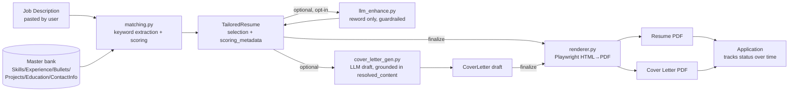

# Resume Tailor — Design

## Context

Job hunting at volume means tailoring a resume to each posting: reading a JD, pulling the
right bullets from a personal history, and formatting the result well. Doing this by hand
doesn't scale past a handful of applications, and prior attempts at fully-automated (LLM
end-to-end) resume generation were unsatisfying — formatting, font, and content quality were
inconsistent from run to run.

The core design decision: **separate content selection from rendering**.

- **Selection** is a deterministic, explainable, tag-based matching engine. Given a job
  description and a hand-curated bank of resume content (skills, experience bullets, projects,
  education), it scores and picks the best-matching subset. An LLM rewrite pass exists but is
  strictly opt-in, guardrailed, and never chooses *what* content appears — only how an
  already-selected bullet is worded.
- **Rendering** is a single, fixed, hand-approved HTML/CSS template rendered to PDF via headless
  Chromium (Playwright). Formatting is solved once, by hand, and never re-gambled per export.

This is a personal, single-user tool — no auth, no multi-tenancy, no job-board scraping. The
user pastes a JD, reviews/adjusts the auto-selected content, optionally requests an LLM pass,
previews, and exports a PDF with a deterministic filename. An application tracker records what
was sent and its outcome.

## Architecture

## Data model

**Master bank** (content library, populated manually via CRUD UI — no resume-file parsing):
`Skill(id, name, category, tags[])`, `ExperienceEntry(id, company, title, location, start_date,
end_date?, display_order)`, `Bullet(id, experience_entry_id?, project_id?, text, tags[],
impact_metric?, is_active)` — belongs to exactly one of an experience entry or a project,
enforced with a DB `CheckConstraint`, `Project(id, name, description, tech_tags[], link?,
display_order)`, `EducationEntry(id, institution, degree, field, start_date, end_date?, gpa?)`,
`ContactInfo` — single-row config (name, email, phone, location, links).

**Tailoring/snapshot layer:**
- `JobDescription(id, company, role_title, raw_text, extracted_keywords[], created_at)`
- `TailoredResume(id, job_description_id, selected_experience_bullet_ids[],
  selected_project_ids[], selected_skill_ids[], selected_education_ids[], scoring_metadata JSON,
  llm_enhanced bool, llm_enhanced_bullets JSON, resolved_content JSON, rendered_pdf_path,
  rendered_filename, status "draft"/"finalized", created_at, finalized_at)`. `resolved_content`
  is populated at finalize-time with the literal rendered text — the authoritative record of
  what was actually sent, independent of later master-bank edits. Once `status="finalized"`,
  the application layer rejects further edits (immutable snapshot).
- `CoverLetter(id, tailored_resume_id, job_description_id, generated_text, edited_text,
  llm_generated bool, rendered_pdf_path, rendered_filename, status "draft"/"finalized",
  created_at, finalized_at)` — always LLM-generated (no rule-based way to write prose cover
  letters), but grounded strictly in the linked `TailoredResume.resolved_content` + JD, never
  auto-finalized.

**Application tracking:**
- `Application(id, tailored_resume_id?, cover_letter_id?, company, role_title, date_applied,
  status enum [applied/interview/offer/rejected/withdrawn], job_description_id, notes,
  created_at, updated_at)`
- `ApplicationStatusEvent(id, application_id, status, changed_at, note)` — append-only timeline.

Chain: `JobDescription` → `TailoredResume` (scored/selected/optionally LLM-tightened + rendered
PDF) → optional `CoverLetter` (LLM-drafted from the tailored resume, reviewed, rendered) →
`Application` (tracks outcome, links both documents).

## Component breakdown

### Master bank + CRUD (implemented — Slice 1)
`app/models/{skill,experience,bullet,project,education,contact}.py`,
`app/schemas/*.py`, `app/api/routes/bank.py`. Plain CRUD, no auth. `Bullet`'s discriminated FK
is the one piece of real logic: a `CheckConstraint` at the DB level plus a pydantic
`model_validator` at the API level (so invalid states are rejected on both create and update,
before hitting the DB where possible). Frontend: `frontend/src/pages/BankPage.tsx` +
`components/bank/*`, all server state through React Query hooks in `frontend/src/api/bank.ts`.

### Matching engine (`app/services/matching.py`, Slice 3)
1. `extract_keywords(jd_text)` — lowercase, tokenize, stopword-strip, bigrams for phrases like
   "machine learning"; optional canonical alias map ("js" → "javascript"). No ML dependency.
2. `score_bullet(bullet, jd_keywords) -> float` — tag-overlap weighted above text-substring
   overlap. Same scoring applied to `Skill`/`Project` rows.
3. Per-section top-N selection with configurable caps (e.g. 3 bullets/experience entry, 6
   skills, 2 projects), overridable per request.
4. Returns `scoring_metadata` (which keywords matched which bullet) alongside selection, so the
   review UI can show *why* something was picked and the user can override.
5. Deterministic and fully unit-testable: fixed JD + fixed bank fixture → assert exact selected
   IDs.

### LLM opt-in features (`app/services/llm_client.py`, `llm_enhance.py`, `cover_letter_gen.py`,
Slices 6-7)
- Both bullet enhancement and cover letter generation are explicit-trigger only, gated by
  independent feature flags (`ENABLE_LLM_ENHANCE`, `ENABLE_COVER_LETTER`, both default `false`)
  so the app works fully with zero API key for the core resume-tailoring flow.
- **Bullet enhance** (`POST /tailor/{id}/enhance`): prompt receives the JD + already-selected
  bullet texts only — never the full master bank; the LLM rephrases, it never chooses content.
  Guardrails: reword/reorder only, never add unstated skills/tools/numbers/claims; return each
  bullet 1:1 paired with its original for diffing; flag large length/structure deviations for
  manual review instead of auto-accepting.
- **Cover letter generate** (`POST /cover-letters`): prompt receives the JD + the *finalized
  selection* of resume content (`TailoredResume.resolved_content`, or the current selection if
  still draft) + `ContactInfo` only. Guardrails: strictly ground claims in the supplied resume
  content, never invent employers/dates/skills/metrics not present there; output is always a
  `status="draft"` row requiring explicit user review + edit before `finalize`.
- Frontend shows original-vs-suggested side by side for bullets (accept/reject per bullet), and
  an editable textarea pre-filled with the draft for cover letters — neither ever silently
  overwrites the immutable finalized/`resolved` fields.
- Use the `anthropic` SDK; check current model IDs/pricing at build time (consult the
  workspace's `claude-api` skill) rather than hardcoding from memory.

### PDF rendering (`app/services/renderer.py`, Slice 2)
- Two fixed templates (`resume_template.html`, `cover_letter_template.html`), each hand-designed
  once and approved by the user, never regenerated by AI per document.
- Render resolved content into the relevant template → HTML string → Playwright
  (`chromium.launch()` headless, `page.set_content()`, `page.pdf()`) → PDF file.
- Frontend preview loads the *same* rendered HTML (an endpoint returning rendered HTML, shown in
  an iframe) before finalize, for both resume and cover letter, so preview == PDF exactly.
- Document `playwright install chromium` in setup instructions.

### Filename sanitization (`app/services/filename.py`, Slice 2/4)
`build_filename(first, last, doc_kind, company, role_title) -> str`, patterns
`{First}_{Last}_Resume_{Company}_{RoleTitle}.pdf` and
`{First}_{Last}_CoverLetter_{Company}_{RoleTitle}.pdf`, sanitized (strip filesystem-unsafe
chars, collapse whitespace, truncate, normalize Unicode). Pure function, unit-tested against
edge cases (slashes/ampersands in company names, very long titles).

### Application tracker (Slice 5)
`app/models/application.py`, `app/models/application_status_event.py`, CRUD + status-transition
routes, `frontend/src/pages/ApplicationsPage.tsx` / `ApplicationDetailPage.tsx`. Links a
finalized `TailoredResume` and optional `CoverLetter` to an `Application`, with an append-only
`ApplicationStatusEvent` timeline.

## V1 scope — explicitly OUT

- Auto-submitting applications to job boards
- Job scraping / board integrations (JD is pasted manually)
- Multi-user auth (single-user personal tool — no login, no JWT/refresh-token machinery)
- Multiple/editable resume or cover-letter templates (one fixed template each; template changes
  = code changes)
- Resume parsing from existing PDF/Word files (bank is populated manually)
- Application-funnel analytics/charts (V2, once there's real data)
- Real-time collaboration/sharing
- Cascading re-tailoring when the master bank changes after a resume is finalized (snapshots
  are immutable by design)

## Build order

1. **Skeleton + bank CRUD** (done). Repo scaffold, Postgres via docker-compose, `/health`/
   `/ready`, first Alembic migration (Skill/ExperienceEntry/Bullet/Project/EducationEntry/
   ContactInfo), bank CRUD routes + `BankPage`, CI gate (`ruff` + `mypy` + `pytest` against real
   Postgres, plus a frontend build/lint job).
2. **PDF rendering pipeline in isolation** (done). Fixed resume template
   (`app/templates/resume_template.html`), Jinja2 + Playwright renderer (`app/services/renderer.py`),
   sanitized filename builder (`app/services/filename.py`), `scripts/render_sample_resume.py`
   producing a sample PDF for visual review.
3. **JD input + matching engine** (done). `JobDescription` model + Alembic migration,
   `app/services/matching.py` (stdlib-only `extract_keywords`/`score_bullet`/`score_skill`/
   `score_project`/`match_bank_to_job_description`), `POST /job-descriptions` +
   `POST /job-descriptions/{id}/match`, unit tests with fixed fixtures. Experience entries and
   education are always included wholesale (nothing to score them by); only their bullets,
   skills, and projects are ranked/capped by JD keyword overlap.
4. **Selection review UI + finalize/export** — `TailorPage` wiring, `SelectionReview`,
   `ResumePreview`, finalize endpoint (denormalize → render → filename → persist).
5. **Application tracker** — `Application`/`ApplicationStatusEvent`, routes,
   `ApplicationsPage`/`ApplicationDetailPage`, link from a finalized resume to a new application.
6. **LLM opt-in bullet enhancement** — `llm_client.py`, `llm_enhance.py`, `enhance` endpoint,
   `LLMEnhancePanel` diff UI.
7. **Cover letter generation (last)** — `CoverLetter` model/migration, `cover_letter_gen.py`,
   `cover_letter_template.html`, `cover_letters.py` routes, `CoverLetterPanel`, wire into
   `Application` linking.

Standing quality gate across every slice: `ruff check .` + `mypy app` + `uv run pytest` (real
Postgres via docker-compose) — set up in `.github/workflows/ci.yml` from Slice 1, not
retrofitted later.

## Verification plan (per slice)

- **Slice 1**: `uv run pytest` green against real Postgres; add a couple of bank entries via
  the UI, restart the backend, confirm they persisted.
- **Slice 2**: render the sample content to PDF, open the actual PDF file, and visually
  compare it side-by-side against the same HTML opened directly in a browser.
- **Slice 3**: paste a real JD from an actual posting, run matching against the (by-then-
  populated) bank, manually sanity-check the top-selected bullets make sense.
- **Slice 4**: full manual run — paste a real JD, review/adjust selection, preview, finalize,
  download the PDF, confirm filename and content match what was selected.
- **Slice 5**: create an application tied to a finalized resume, change status a few times,
  confirm the timeline renders and the linked PDF downloads correctly.
- **Slice 6**: run enhancement on real bullets against a real JD; confirm no new claims/tools/
  numbers were introduced; confirm rejecting a suggestion leaves the original bullet untouched.
- **Slice 7**: generate a cover letter draft against a real finalized resume + JD; confirm every
  claim traces back to the resume content; edit, finalize, download, confirm filename and
  application-detail linking.
